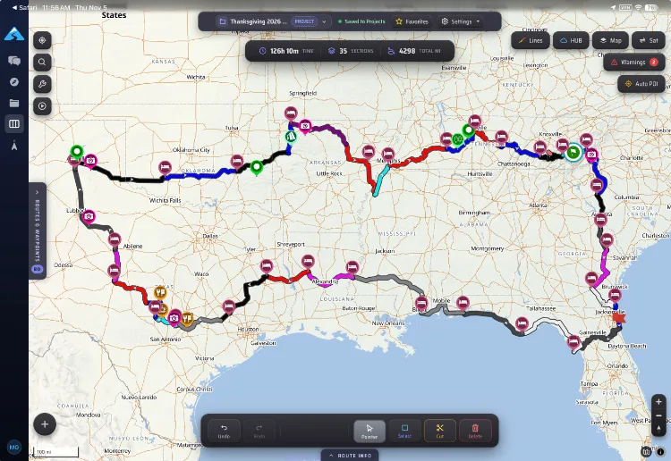

## The trip

As we prepare for the start of our Pan American motorcycle trip we felt we needed a sizable trial run to make sure the bikes, our gear, and our bodies were ready. Our original plan was to take the bikes down into Baja Mexico for a couple of months. As we were in the process of starting to plan that trip, another option came up. A large group of Valarie’s cousins thought it would be fun to do a week during Thanksgiving in St. Augustine Florida. This is a childhood vacation spot for Val and her cousins, since their Grandparents lived there for years. 

The plan to do the week of Thanksgiving in Florida quickly made our Baja trip overly complex. We thought about going to Baja, putting the bikes in storage, and flying to Florida, then returning to Baja. But, then we came up with another idea. Exploring the Southern USA. There was so much of the US that we had not really explored. And on our little Honda 300Ls we could take smaller roads, and see places we would never see by taking highways. So we had the concept of a plan. We then needed to start to work out the route and plan around the weather. 

## The route

