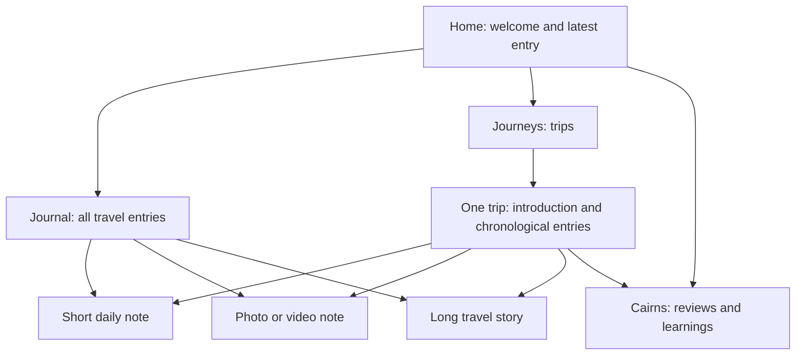

# Field Notebook content map

| Content | Where readers find it | Site destination |
| --- | --- | --- |
| Short daily update | Journal, latest-entry area, associated Journey | `content/posts/<id>/index.md` → `/dispatches/<id>/` |
| Photo/video note | Same as any Journal entry; no separate gallery required | Same post bundle, with delivery media |
| Long travel narrative | Journal and associated Journey | Same post bundle |
| Practical review or learning | Cairns, homepage notes, related Journey | `content/cairns/<id>/index.md` |
| Trip introduction | Journeys and its trip page; entries collected automatically | `content/journeys/<trip-id>/_index.md` |
| About | Header/footer navigation | Existing About page |

A Journey is a collection, not a post type. A long story stays in the Journal; a reusable review or guide belongs in Cairns. `journeys: [trip-id]` connects either kind to a trip. Entry lists require no duplicate writing.

## Authoring and display

Write in Obsidian using [the authoring workflow](../WORKFLOW.md). The publisher supports Journal, Cairn, Journey, and homepage bundles, including folder-named notes. The paths above are generated destinations; do not edit publisher-owned output directly.

The homepage uses the `home/index.md` source for a stable welcome and up to two explicitly selected photographs. It includes the latest Journal excerpt, all Journeys in newest-date-first order, and three recent Cairns. The first Journey may have a thumbnail. On phones these sections stack. The Journal archive remains available through navigation.

A titleless note gets a date/location heading. Named stories retain their title. Journey introductions and entries display authors, their date, and an update date when applicable. `weight` does not control Journey ordering. Introductions can appear before their first daily entry.

Photographs remain in post bundles, with inline images and optional captions. A dedicated gallery grid/lightbox is not currently part of the authoring workflow. See [the publishing contract](publishing-contract.md) for media and deletion behavior.

## Design references

Original mockups are retained in `output/design-studies/`; [the redesign checklist](redesign-content-checklist.md) is a historical handoff, not current setup instructions. Runnable examples live only in the theme's opt-in `exampleSite/` and are exercised by its checks.

Any remaining `sample-*` files listed in the publisher manifest must be retired in Obsidian. `fixture: true` identifies demonstrations; do not carry it into real writing. About and Welcome are preserved for author revision, while Contact and Thank-you remain functional site pages.
