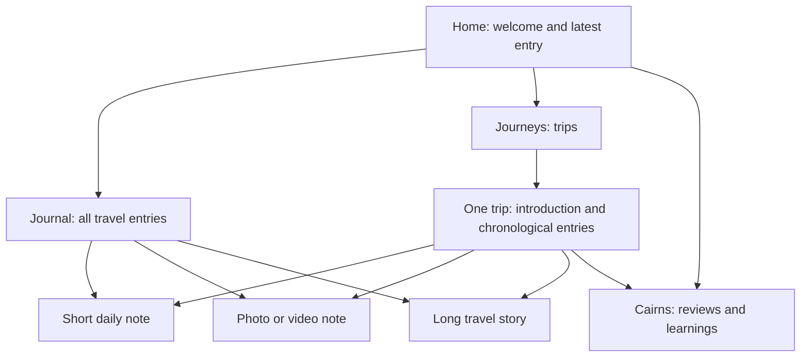

# Field Notebook content map

| Content | Where readers find it | Site destination |
| --- | --- | --- |
| Short daily update | Journal, latest-entry area, associated Journey | `content/posts/<id>/index.md` → `/dispatches/<id>/` |
| Photo/video note | Same as any Journal entry; no separate gallery required | Same post bundle, with delivery media |
| Long travel narrative | Journal and associated Journey | Same post bundle |
| Practical review or learning | Cairns, homepage notes, related Journey | `content/cairns/<id>/index.md` |
| Trip introduction | Journeys and its trip page; entries collected automatically | `content/journeys/<trip-id>/_index.md` |
| About | Header/footer navigation | Existing About page |

A Journey is a collection, not a post type. A long story stays in the Journal; a reusable review or guide belongs in Cairns. `journeys: [trip-id]` connects either kind to a trip. Entry lists require no duplicate writing.

## Draft review examples

The `sample-*` bundles are authorized design examples, labeled as samples, `draft: true`, and `fixture: true`. They contain explanatory sample text and synthetic media, not invented first-person travel accounts. Normal production builds exclude their pages and resources. Draft previews include them; RSS excludes them. They are public-safe Git content, not private drafts.

Run `hugo server --buildDrafts` to see the populated homepage, Journal, Journey, and Cairn views. The newest example is intentionally a short text-only daily update. Remove or replace the sample bundles when real content is ready.

## Authoring boundary

All types are intended to be authored in Obsidian. The existing publisher mapping supports post bundles; complete routing for Cairns, Journey introductions, and homepage media/settings remains integration work. These review examples are hand-maintained fixtures outside publisher ownership, not a new daily authoring workflow. Do not use this document as evidence that new publisher routing has been implemented.

## Visual review

Homepage photographs remain optional and unset in production configuration. The isolated theme demo has synthetic photographs for exercising the overlapping layout. The existing video shortcode autoplays muted; the original no-autoplay preference still needs resolution separately.
